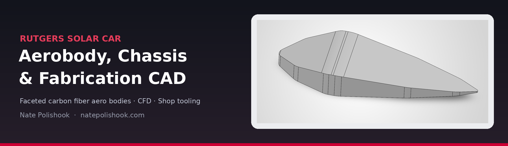
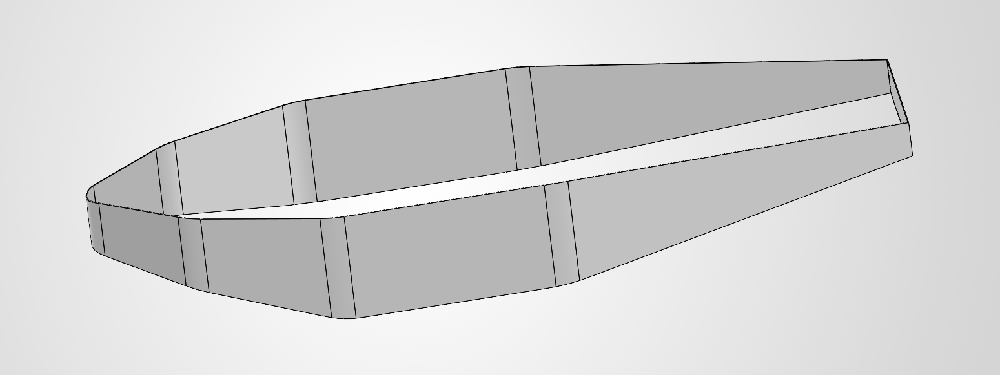
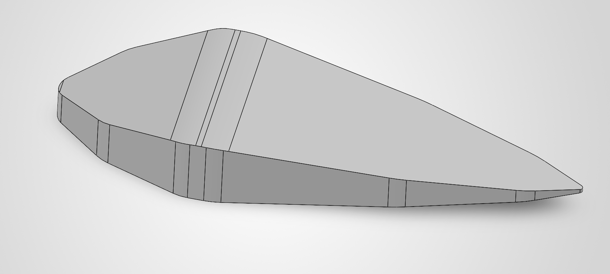
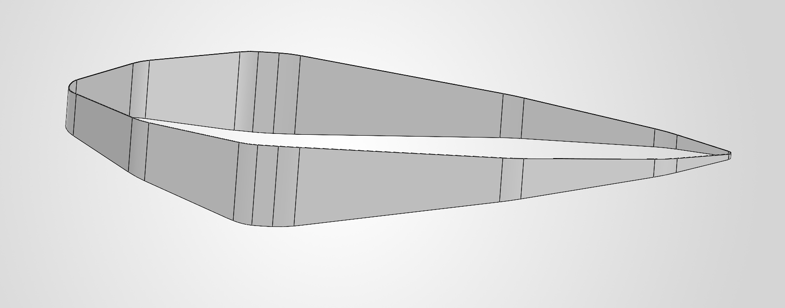
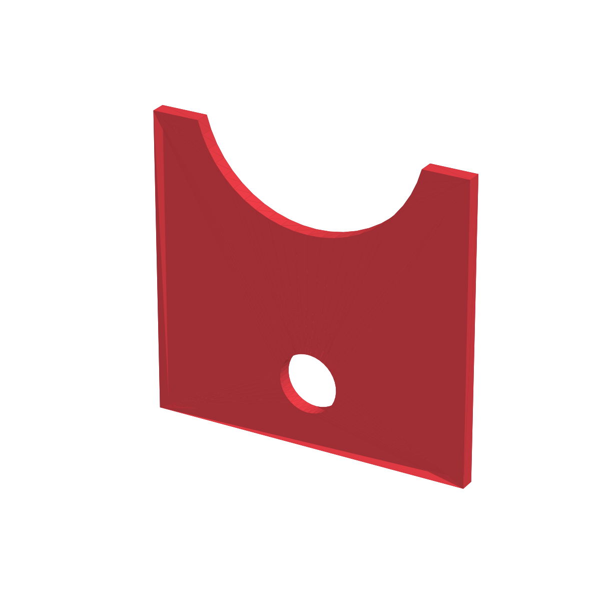

<p align="center">
  
</p>

<p align="center">
  
  
  
  
  
</p>

<p align="center">
  <a href="https://natepolishook.com/projects/solar-car"><b>Project page</b></a> ·
  <a href="https://natepolishook.com">natepolishook.com</a> ·
  <a href="https://www.linkedin.com/in/nate-polishook">LinkedIn</a>
</p>

# Rutgers Solar Car: Mechanical Design & Fabrication

CAD and design work I'm doing as a mechatronics engineer on the **Rutgers Solar Car** team (August 2026 to present). The focus is hardware that is actually practical to build in-house: a faceted carbon fiber aerobody, lighter and stronger A-arms, weld-on tabs for mounting components to the chassis, and shop tooling for the manual mills and lathes.

> **The core problem:** curved carbon fiber parts are slow and expensive to lay up. So instead of a smooth, doubly curved shell, every aerobody concept here is built from **flat panels joined by filleted creases**. Flat panels can be laid up on simple molds or cut from plate, which makes the body realistic for a student team to manufacture.

---

## Contents

- [Aerobody concepts](#aerobody-concepts)
- [Tail geometry comparison](#tail-geometry-comparison)
- [Key specs](#key-specs)
- [CFD plan](#cfd-plan)
- [Fabrication parts](#fabrication-parts)
- [Repository layout](#repository-layout)
- [Opening the files](#opening-the-files)
- [Roadmap](#roadmap)

---

## Aerobody concepts

Three tail variants share the same nose and front section and differ only behind the widest point. Each one exists as a **solid** body (used for CFD) and a **shelled** body (5 mm wall, open top and bottom, used for layup planning and FEA).

### A: Kamm cutoff tail

A long flat section into a 10° taper, then a blunt vertical cutoff. Shortest body, simplest panels, highest expected base drag.

| Solid (CFD body) | Shelled (5 mm wall) |
|:---:|:---:|
|  |  |

### B: Progressive pointed tail

A short flat section into three progressively steeper facets (9°, 15°, 25°) that close to a 40 mm trailing edge. More panels, but the gentlest pressure recovery of the three.

| Solid (CFD body) | Shelled (5 mm wall) |
|:---:|:---:|
|  |  |

### C: Straight section, single taper

A medium flat section into one 16.8° taper to a 40 mm trailing edge. Fewest tail panels of the pointed options, with a higher risk of flow separation on the taper.

| Solid (CFD body) | Shelled (5 mm wall) |
|:---:|:---:|
|  |  |

---

## Tail geometry comparison

Plan view and side profile of all three variants, plotted straight from the sketch vertices in the SolidWorks parts (fillets not drawn).

<p align="center">
  
</p>

---

## Key specs

**Shared geometry (all variants)**

| Parameter | Value |
|---|---|
| Max width | 1600 mm |
| Max height | 650 mm body, 150 mm ground clearance |
| Nose | 2 facets at 40° / 20°, 1401 mm long, R160 tip, R400 creases |
| Side profile fillets | R150, R150, R1000, R2000, R3000 |
| Wall thickness (shelled) | 5 mm |
| Frontal area | 1.04 m² |
| Rules envelope (ASC) | 5.0 m long, 1.6 m high, 2.2 m wide max |

**Per variant**

| | A: Kamm cutoff | B: Progressive point | C: Single taper |
|---|:---:|:---:|:---:|
| Overall length | 4692.5 mm | 4847.4 mm | 4787.3 mm |
| Flat mid-section | 1300 mm | 300 mm | 900 mm |
| Plan-view tail angle(s) | 10° | 9° / 15° / 25° | 16.8° |
| Side tail taper (top / bottom) | 8.0° / 4.0° | 7.2° / 3.6° | 9.0° / 4.5° |
| Tail end | 866 × 212 mm flat base | 40 mm trailing edge | 40 mm trailing edge |
| Solid volume | 3.213 m³ | 2.352 m³ | 2.564 m³ |
| Shell volume (5 mm) | 0.0259 m³ | 0.0208 m³ | 0.0225 m³ |

> Side profile is a placeholder until final chassis and driver-envelope numbers are locked in.

---

## CFD plan

The three variants are being compared in **ANSYS Fluent** with identical settings so the ranking is fair.

- **Setup:** steady, pressure-based coupled solver, k-ω SST, second-order discretization, symmetric half model
- **Domain:** 15 m upstream, 30 m downstream, ~1.1% blockage, moving ground at 22 m/s
- **Mesh:** Fluent watertight workflow, poly-hexcore with inflation layers on the body and refinement boxes for the underbody and wake
- **Output:** drag coefficient averaged over 500 iterations; at 22 m/s every **0.01 of Cd ≈ 68 W** of aero power, which is a big deal on a solar budget
- **Validation:** Ahmed body (0° squareback) as a sanity check, plus a coarse vs. medium mesh run to confirm the A/B/C ranking holds

---

## Fabrication parts

Alongside the body I'm designing hardware for the chassis and for the shop.

### Tube contour gauge

Shop tooling for the chassis tube work: a two-piece hex body with a bored center and a ring of hole features around it.

| SolidWorks render | STL preview |
|:---:|:---:|
|  |  |

### Weld-on aero tabs

Thin plate tabs with a saddle cut that sits on a round tube and a bolt hole for mounting body panels and components to the welded chassis.

<p align="center">
  
</p>

---

## Repository layout

```text
solar-car/
├── Aero body/
│   ├── Solid/                      # closed bodies for CFD
│   │   ├── Aerobody_A_KammCutoffTail.SLDPRT
│   │   ├── Aerobody_B_ProgressivePointedTail.SLDPRT
│   │   └── Aerobody_C_StraightSection_SingleTaper.SLDPRT
│   └── Shelled/                    # 5 mm wall, open top/bottom, for layup and FEA
│       ├── Aerobody_A_KammCutoffTail_Shelled.SLDPRT
│       ├── Aerobody_B_ProgressivePointedTail_Shelled.SLDPRT
│       └── Aerobody_C_StraightSection_SingleTaper_Shelled.SLDPRT
├── aerobody.SLDPRT                 # original aerobody concept
├── aero tabs v2.SLDPRT / .STL      # weld-on mounting tabs
├── new_tabs.SLDPRT                 # tab revision
├── tube_contour_gauge.SLDPRT / .STL
└── docs/images/                    # renders and plots used in this README
```

Every aerobody part uses the same clean, fully editable feature tree:

```text
Sketch1 → TopView_Extrude → (Shell1, shelled only) → Sketch2 → SideProfile_Cut
```

All dimensions are driven from the origin per corner plus fillet radii, so any facet angle or length can be changed with a single dimension edit.

---

## Opening the files

- Parts are **SolidWorks** `.SLDPRT` files. Open them with **File → Open** (type: Part).
- The `.STL` files can be previewed directly on GitHub or opened in any slicer/viewer.
- For CFD, export the **Solid** bodies as Parasolid (`.x_t`) for ANSYS Workbench.

---

## Roadmap

- [x] Three panelized aerobody concepts (A, B, C), solid and shelled
- [x] Tube contour gauge and weld-on tabs
- [x] Hand calcs and CFD setup
- [ ] Run Fluent on A, B and C and pick the lowest-drag variant
- [ ] Round the long top/side edges to control edge vortices
- [ ] Parametric sweep of the winning tail in DesignXplorer
- [ ] Full-car crosswind (yaw) runs
- [ ] Lock side profile to final chassis and driver envelope
- [ ] Layup plan and mold design for the panels
- [ ] A-arm design for lower weight and higher stiffness

---

<p align="center">
  Built by <a href="https://natepolishook.com"><b>Nate Polishook</b></a>, Mechanical Engineering @ Rutgers University<br>
  <a href="mailto:natepolishook88@gmail.com">Email</a> ·
  <a href="https://www.linkedin.com/in/nate-polishook">LinkedIn</a> ·
  <a href="https://github.com/natepol88-stack">GitHub</a>
</p>
