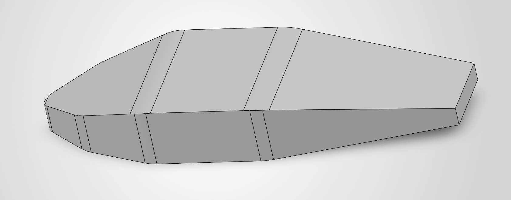
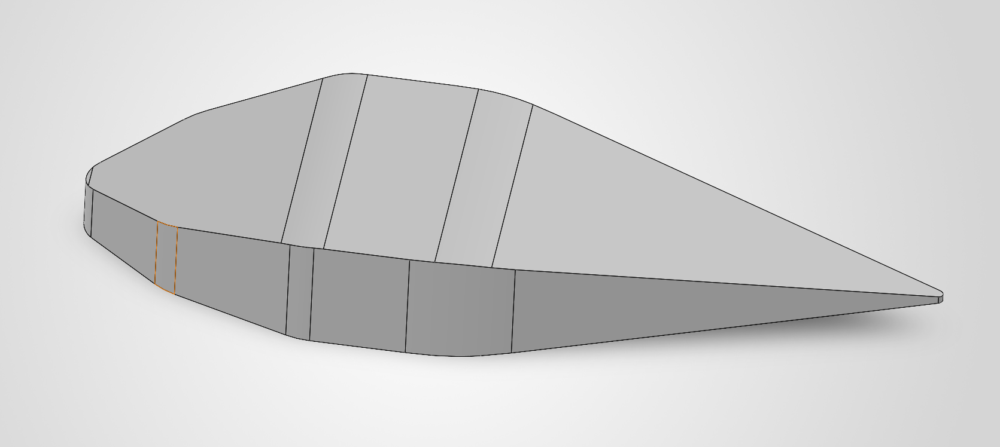
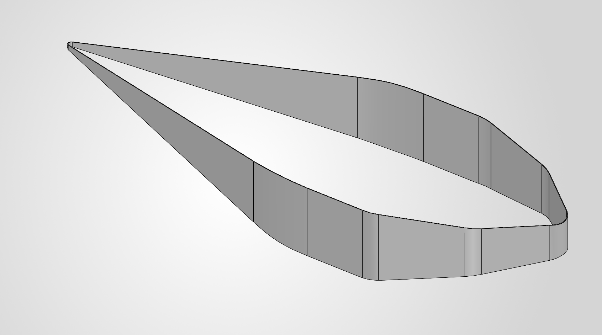
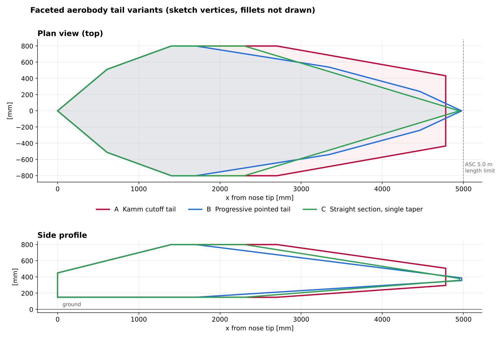
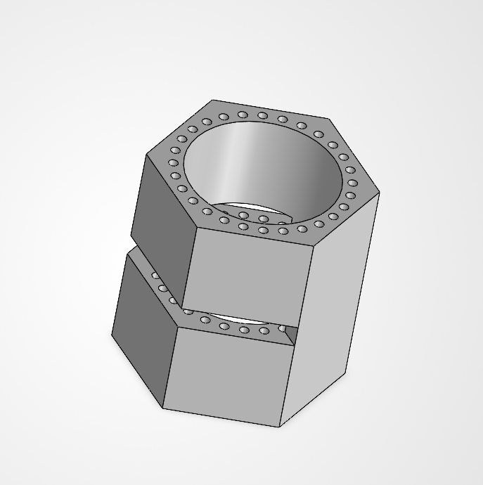
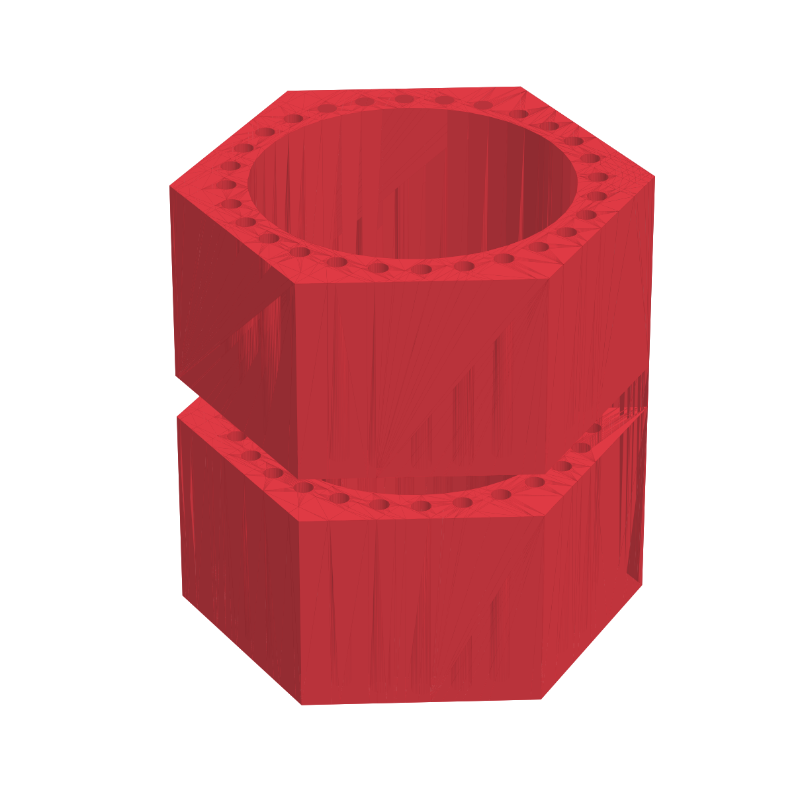

<p align="center">
  
</p>

<p align="center">
  
  
  
  
  
</p>

<p align="center">
  <a href="https://natepol88-stack.github.io/solar-car/cfd-brief/"><b>CFD brief (tails A/B/C)</b></a> ·
  <a href="https://natepol88-stack.github.io/solar-car/cfd-brief-c-v2/"><b>CFD brief (C v2 redesign)</b></a> ·
  <a href="https://natepolishook.com/projects/solar-car"><b>Project page</b></a> ·
  <a href="https://natepolishook.com">natepolishook.com</a> ·
  <a href="https://www.linkedin.com/in/nate-polishook">LinkedIn</a>
</p>

# Rutgers Solar Car: Mechanical Design & Fabrication

CAD and design work I'm doing as a mechatronics engineer on the **Rutgers Solar Car** team (August 2026 to present). The focus is hardware that is actually practical to build in-house: a faceted carbon fiber aerobody, lighter and stronger A-arms, weld-on tabs for mounting components to the chassis, and shop tooling for the manual mills and lathes.

> **The core problem:** curved carbon fiber parts are slow and expensive to lay up. So instead of a smooth, doubly curved shell, every aerobody concept here is built from **flat panels joined by filleted creases**. Flat panels can be laid up on simple molds or cut from plate, which makes the body realistic for a student team to manufacture.

---

## Contents

- [Aerobody concepts](#aerobody-concepts)
- [Tail geometry comparison](#tail-geometry-comparison)
- [Key specs](#key-specs)
- [CFD results](#cfd-results)
- [C v2 redesign: flat panels](#c-v2-redesign-flat-panels)
- [Fabrication parts](#fabrication-parts)
- [Repository layout](#repository-layout)
- [Opening the files](#opening-the-files)
- [Roadmap](#roadmap)

---

## Aerobody concepts

Three tail variants share the same nose and front section and differ only behind the widest point. Each one exists as a **solid** body (used for CFD) and a **shelled** body (5 mm wall, open top and bottom, used for layup planning and FEA).

### A: Kamm cutoff tail

A long flat section into a 10° taper, then a blunt vertical cutoff. Shortest body, simplest panels, highest expected base drag.

| Solid (CFD body) | Shelled (5 mm wall) |
|:---:|:---:|
|  |  |

### B: Progressive pointed tail

A short flat section into three progressively steeper facets (9°, 15°, 25°) that close to a 40 mm trailing edge. More panels, but the gentlest pressure recovery of the three.

| Solid (CFD body) | Shelled (5 mm wall) |
|:---:|:---:|
|  |  |

### C: Straight section, single taper

A medium flat section into one 16.8° taper to a 40 mm trailing edge. Fewest tail panels of the pointed options. **Lowest drag in CFD (Cd 0.0988), with no flow separation on the taper.**

| Solid (CFD body) | Shelled (5 mm wall) |
|:---:|:---:|
|  |  |

---

## Tail geometry comparison

Plan view and side profile of all three variants, plotted straight from the sketch vertices in the SolidWorks parts (fillets not drawn).

<p align="center">
  
</p>

---

## Key specs

**Shared geometry (all variants)**

| Parameter | Value |
|---|---|
| Max width | 1600 mm |
| Max height | 650 mm body, 150 mm ground clearance |
| Nose | 2 facets at 40° / 20°, 1401 mm long, R160 tip, R400 creases |
| Side profile fillets | R150, R150, R1000, R2000, R3000 |
| Wall thickness (shelled) | 5 mm |
| Frontal area | 1.04 m² |
| Rules envelope (ASC) | 5.0 m long, 1.6 m high, 2.2 m wide max |

**Per variant**

| | A: Kamm cutoff | B: Progressive point | C: Single taper |
|---|:---:|:---:|:---:|
| Overall length | 4692.5 mm | 4847.4 mm | 4787.3 mm |
| Flat mid-section | 1300 mm | 300 mm | 900 mm |
| Plan-view tail angle(s) | 10° | 9° / 15° / 25° | 16.8° |
| Side tail taper (top / bottom) | 8.0° / 4.0° | 7.2° / 3.6° | 9.0° / 4.5° |
| Tail end | 866 × 212 mm flat base | 40 mm trailing edge | 40 mm trailing edge |
| Solid volume | 3.213 m³ | 2.352 m³ | 2.564 m³ |
| Shell volume (5 mm) | 0.0259 m³ | 0.0208 m³ | 0.0225 m³ |

> Side profile is a placeholder until final chassis and driver-envelope numbers are locked in.

---

## CFD results

All three tails were simulated in **ANSYS Fluent 2026 R1** with identical settings: 6 runs (3 tails × coarse and medium mesh), every one converged.

> 📄 **[Open the full CFD brief](https://natepol88-stack.github.io/solar-car/cfd-brief/)**
>
> **Result: tails B and C have about 18% less drag than the Kamm tail (A), worth ~150 W at 22 m/s. B and C are tied, so C wins on manufacturability: one straight taper instead of three facets.**

<p align="center">
  
</p>

| Tail | Cd (coarse) | Cd (medium) | Pressure Cd | Skin friction Cd | Drag power @ 22 m/s |
|---|:---:|:---:|:---:|:---:|:---:|
| A: Kamm cutoff | 0.1209 | 0.1211 | 0.0729 | 0.0482 | 821 W |
| B: Progressive point | 0.1000 | 0.0991 | 0.0593 | 0.0398 | 672 W |
| **C: Single taper** | **0.0992** | **0.0988** | **0.0580** | **0.0408** | **670 W** |

Coarse (~575k cells) and medium (~750k cells) meshes agree within 1% for every tail, so the ranking is not a mesh artifact. The Kamm base itself is only ~1% of A's drag; A loses because it is a bigger body with more wetted surface and a fuller rear.

### Surface pressure (Cp)

Red is air hitting the surface, blue is air accelerating over a crease. B and C recover pressure over a longer taper at the rear.

| A: Kamm | B: Progressive point | C: Single taper |
|:---:|:---:|:---:|
|  |  |  |

### Wall shear stress (separation check)

Negative (blue) x-wall shear means reversed flow. Apart from the nose stagnation point, all three stay attached to the tip, including C's 16.8° taper.

| A: Kamm | B: Progressive point | C: Single taper |
|:---:|:---:|:---:|
|  |  |  |

### Wake (velocity, centerline and mid-height slices)

A leaves a pocket of dead air behind its flat base. B and C close to a thin, fast-recovering wake.

| A: Kamm | B: Progressive point | C: Single taper |
|:---:|:---:|:---:|
|  |  |  |
|  |  |  |

### Setup

- **Solver:** steady, pressure-based coupled, k-ω SST, second order, symmetric half model
- **Domain:** 50 × 7 × 7 m (15 m upstream, 30 m downstream), ~1% blockage, ground moving at 22 m/s
- **Mesh:** Fluent Meshing watertight workflow, poly-hexcore, 8 prism layers on the body (0.5 mm first layer), refinement boxes around the body, underbody and wake
- **Convergence:** Cd averaged over the last 100 iterations; it varied by less than 0.00001 over that window in every run

<p align="center">
  
</p>

**Limits:** body only (no wheels, fairings or canopy), so absolute Cd is optimistic; use it to rank shapes. Student license caps the mesh at ~1M cells, so wall y+ is ~14 (between the ideal ranges). Steady RANS; crosswind runs are next.

**[View the full CFD brief in your browser](https://natepol88-stack.github.io/solar-car/cfd-brief/)**: all 15 Fluent images, results, method and recommendation (source file: [`Aero body/CFD/00_BRIEF/Aerobody_CFD_Brief.html`](Aero%20body/CFD/00_BRIEF/Aerobody_CFD_Brief.html)). Raw numbers: [`CFD_results_summary.csv`](Aero%20body/CFD/00_BRIEF/CFD_results_summary.csv).

---

## C v2 redesign: flat panels

With tail C chosen, I tried to make it even easier to build: replace every curved transition with flat facets so almost every carbon panel is flat. Three variants, each adding one change so the CFD isolates its effect. Same setup as the tail study (half model, 22 m/s, k-omega SST, moving ground, coarse + medium mesh).

> 📄 **[Open the C v2 CFD brief](https://natepol88-stack.github.io/solar-car/cfd-brief-c-v2/)**

| Variant | Change | Cd (medium) | Downforce | Drag power @ 22 m/s |
|:--|:--|--:|--:|--:|
| **C original** | curved transitions (fillets) | **0.0988** | 133 N | **670 W** |
| v2A Faceted | every fillet replaced by flat facets (kinks up to 14°) | 0.1075 | 133 N | 729 W |
| v2B +LowLift | + tail bottom kick 4.5° → 2.5°, top drops earlier | 0.1065 | 80 N | 722 W |
| v2C +LongTaper | + plan taper 16.8° → 14.7° | 0.1066 | 75 N | 723 W |

<p align="center">
  
</p>

**What I learned**

- **Sharp faceting cost 59 W (+8.8%)**, all of it pressure drag: every kink makes a thin suction line, worst at the shoulders. No flow separation anywhere.
- **The low-downforce side profile works:** 40% less downforce (less tire load and rolling loss) and slightly less drag. Worth carrying back into C.
- **The longer taper did nothing:** less skin friction, the same amount back as pressure drag, and less room inside.
- Coarse vs medium mesh within 0.73% on every variant.

| C original | v2A Faceted | v2B +LowLift | v2C +LongTaper |
|:---:|:---:|:---:|:---:|
|  |  |  |  |

**Next (C v3):** original C + the LowLift side profile, then test finer facets (5° or less per kink) and a hybrid that keeps the small nose corners as single-curve strips, to find how flat the panels can go before drag climbs.

CAD: [`Aero body/C_v2/`](Aero%20body/C_v2) (solid + shelled, all editable, coordinates in [`README_C_v2.md`](Aero%20body/C_v2/README_C_v2.md)). Raw numbers: [`CFD_C_v2_results_summary.csv`](Aero%20body/CFD/00_BRIEF/CFD_C_v2_results_summary.csv).

---

## Fabrication parts

Alongside the body I'm designing hardware for the chassis and for the shop.

### Tube contour gauge

Shop tooling for the chassis tube work: a two-piece hex body with a bored center and a ring of hole features around it.

| SolidWorks render | STL preview |
|:---:|:---:|
|  |  |

### Weld-on aero tabs

Thin plate tabs with a saddle cut that sits on a round tube and a bolt hole for mounting body panels and components to the welded chassis.

<p align="center">
  
</p>

---

## Repository layout

```text
solar-car/
├── Aero body/
│   ├── Solid/                      # closed bodies for CFD
│   │   ├── Aerobody_A_KammCutoffTail.SLDPRT
│   │   ├── Aerobody_B_ProgressivePointedTail.SLDPRT
│   │   └── Aerobody_C_StraightSection_SingleTaper.SLDPRT
│   ├── Shelled/                    # 5 mm wall, open top/bottom, for layup and FEA
│   │   ├── Aerobody_A_KammCutoffTail_Shelled.SLDPRT
│   │   ├── Aerobody_B_ProgressivePointedTail_Shelled.SLDPRT
│   │   └── Aerobody_C_StraightSection_SingleTaper_Shelled.SLDPRT
│   ├── C_v2/                       # flat-panel redesign of C: v2A/B/C solid + shelled, screenshots
│   └── CFD/                        # ANSYS Fluent studies (tails A/B/C, then C v2)
│       ├── 00_BRIEF/               # both results briefs (HTML), charts, results CSVs
│       ├── 01_Images_Fluent/       # Fluent renders (tails A/B/C; C_v2/ for the redesign)
│       ├── 02_Results_Data/        # Cd/Cl history for every run
│       ├── 04_Setup_and_Batch/     # Fluent journals and batch runner
│       └── 05_Geometry/            # exported bodies + half-car air domains (C_v2/ too)
├── aerobody.SLDPRT                 # original aerobody concept
├── aero tabs v2.SLDPRT / .STL      # weld-on mounting tabs
├── new_tabs.SLDPRT                 # tab revision
├── tube_contour_gauge.SLDPRT / .STL
└── docs/                         # README images + the two web briefs (cfd-brief, cfd-brief-c-v2)
```

Every aerobody part uses the same clean, fully editable feature tree:

```text
Sketch1 → TopView_Extrude → (Shell1, shelled only) → Sketch2 → SideProfile_Cut
```

All dimensions are driven from the origin per corner plus fillet radii, so any facet angle or length can be changed with a single dimension edit.

---

## Opening the files

- Parts are **SolidWorks** `.SLDPRT` files. Open them with **File → Open** (type: Part).
- The `.STL` files can be previewed directly on GitHub or opened in any slicer/viewer.
- For CFD, export the **Solid** bodies as Parasolid (`.x_t`) for ANSYS Workbench. Ready-made exports and air domains are in `Aero body/CFD/05_Geometry/`.
- Fluent solution and mesh files (`.h5`, about 1.4 GB) are kept locally and not in this repo.

---

## Roadmap

- [x] Three panelized aerobody concepts (A, B, C), solid and shelled
- [x] Tube contour gauge and weld-on tabs
- [x] Hand calcs and CFD setup
- [x] Run Fluent on A, B and C and pick the lowest-drag variant (C)
- [x] Flat-panel redesign of C (v2A/B/C) and CFD: faceting costs 59 W, LowLift profile worth keeping
- [ ] C v3: original C + LowLift profile, fine-facet and hybrid versions
- [ ] Round the long top/side edges to control edge vortices
- [ ] Parametric sweep of the winning tail in DesignXplorer
- [ ] Crosswind (yaw 5° / 10°) runs on A and C
- [ ] Full-car model with wheels, fairings and canopy
- [ ] Confirm driver, battery and chassis packaging inside tail C
- [ ] Lock side profile to final chassis and driver envelope
- [ ] Layup plan and mold design for the panels
- [ ] A-arm design for lower weight and higher stiffness

---

<p align="center">
  Built by <a href="https://natepolishook.com"><b>Nate Polishook</b></a>, Mechanical Engineering @ Rutgers University<br>
  <a href="mailto:natepolishook88@gmail.com">Email</a> ·
  <a href="https://www.linkedin.com/in/nate-polishook">LinkedIn</a> ·
  <a href="https://github.com/natepol88-stack">GitHub</a>
</p>
